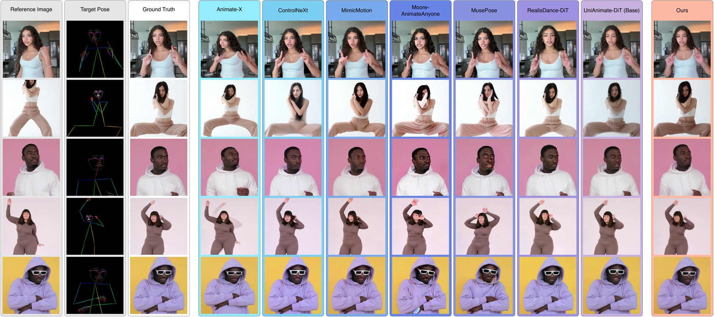

<div align="center">

# One Image Is Enough: Self-Generated Supervision for Personalizing Human Video Diffusion at Test Time

**WACV 2027**

Sadman Rakib Pinon<sup>1,2</sup>, Adamo Orsini<sup>1,2</sup>, Yanis Falaki<sup>1</sup>, Linlian Jiang<sup>1,2</sup>,
Jacob Kingi<sup>1,2</sup>, Yang Wang<sup>1,2</sup>, Xinxin Zuo<sup>1</sup>

<sup>1</sup>Concordia University &nbsp;&nbsp; <sup>2</sup>Mila – Quebec AI Institute

Paper (coming soon) · arXiv (coming soon) · Weights (coming soon) · Benchmark (coming soon)

</div>

<p align="center">
  
</p>

## TL;DR

Pose-driven human video models lose the subject's face and garment details as the pose moves away
from the reference image. We personalize the model to each subject **at test time, from the single
reference image alone**: a pose-conditioned generator synthesizes pseudo-ground-truth frames of the
subject at new poses, a reward-guided sampler keeps the most identity-consistent ones, and a
per-subject LoRA is trained on **static clips** of them so the video model learns appearance without
losing its motion prior. No subject video, ground truth, or labels are needed.

## News

- **[2026-10]** Paper accepted to **WACV 2027**.

## Release plan

Code and weights are being cleaned up and will be released by **December 2026**.

- [x] Paper accepted (WACV 2027)
- [ ] arXiv preprint and project page
- [ ] Environment setup and model download scripts
- [ ] Inference: per-subject test-time adaptation (static-clip LoRA) on UniAnimate-DiT
- [ ] Pseudo-ground-truth generation with the pose-conditioned generator and reward-guided sampling
- [ ] Pretrained generator weights (TikTok, UBC Fashion) on Hugging Face
- [ ] Generator training code
- [ ] Evaluation protocol and scripts (PSNR, SSIM, LPIPS, FID, FVD, FID-VID, FaceID, BodySIM, dtSSD)
- [ ] Unseen100-Val benchmark (gated release)

Watch or star the repository to be notified when the release lands.

## Acknowledgements

This work builds on the following open-source projects; we thank their authors.

- [UniAnimate-DiT](https://github.com/ali-vilab/UniAnimate-DiT): the base pose-driven human video model
- [Wan2.1](https://github.com/Wan-Video/Wan2.1): the video diffusion backbone of UniAnimate-DiT
- [FLUX.1 Kontext](https://github.com/black-forest-labs/flux): the base of our pseudo-ground-truth generator
- [DiffSynth-Studio](https://github.com/modelscope/DiffSynth-Studio): the training and inference framework

## License

- **Code:** [Apache License 2.0](LICENSE).
- **Generator weights** (to be released) are derivatives of FLUX.1 Kontext [dev] and are distributed under the
  [FLUX.1 [dev] Non-Commercial License](https://huggingface.co/black-forest-labs/FLUX.1-Kontext-dev/blob/main/LICENSE.md).
- **Third-party models** (Wan2.1, UniAnimate-DiT, FLUX.1 Kontext) are not redistributed here and remain under
  their own licenses; download them from their official sources.
- **Datasets:** TikTok and UBC Fashion remain under their original terms. Unseen100-Val will be released
  under its own terms for research use.

## Citation

If you find this work useful, please cite:

```bibtex
@inproceedings{pinon2027oneimage,
  title     = {One Image Is Enough: Self-Generated Supervision for Personalizing Human Video Diffusion at Test Time},
  author    = {Pinon, Sadman Rakib and Orsini, Adamo and Falaki, Yanis and Jiang, Linlian and
               Kingi, Jacob and Wang, Yang and Zuo, Xinxin},
  booktitle = {Proceedings of the IEEE/CVF Winter Conference on Applications of Computer Vision (WACV)},
  year      = {2027}
}
```

## Contact

Sadman Rakib Pinon: sadmanrakib.pinon@mail.concordia.ca
